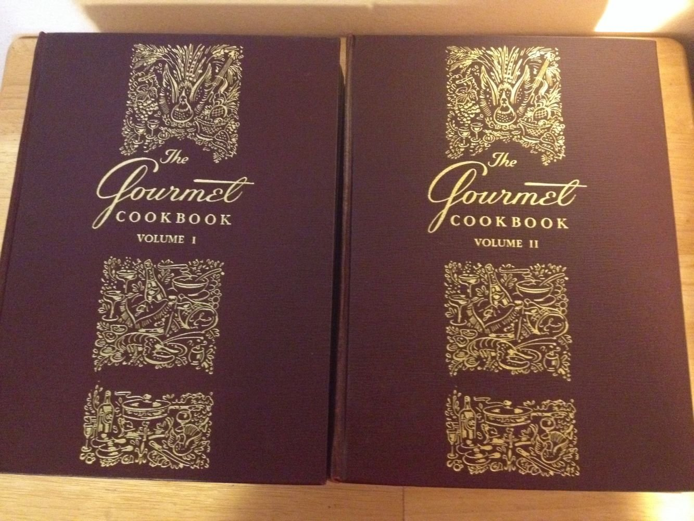

​		晚上能有自己的一个小时是多么令人感觉愉快, 打字机的声音, 和一口泡的柠檬水, 我真的爱了~

​		当初决定一本书不读完不读下一本书, 我pick 了 I feel bad about my neck, 现在第二章, 好长, 读完要累晕了, 废话不多说, 先写一点. 

 # Serial Monogamy: A Memori

​		题目就很有意思: "连续一夫一妻制, 一段回忆", 但是作者是从食谱开始讨论的.

​		第一段,  Nora Ephron 介绍了她母亲给她的第一本食谱, 在1962年, 叫做 "_The Gourmet Cookbook(volume 1)_ "。 作者对这本书的介绍是：

> "a tome, with a gloomy reddish brown binding. It was assembled by the editors of _Gourmet_ magazine and punctuated by the splendid, reverent, slightly lugubrious pictures of food the magazine was famous for."
>
> 
>
> "一本厚重的， 有着红色泛棕色的装订。它被Gourmet 杂志的编辑整合起来并且里面夹着华丽的， 虔诚的， 有点忧郁的食物的图片， 杂志以这些食物著称。"

​		这个介绍很形象。:joy: 下面是这本书的封面图片，看着真的很有气势，我都想买一本了！

​		这本书改变了她母亲的生活。她家里的厨师也开始做别的食物。不久之后，原本不做饭的母亲， 开始在厨房做中国春卷，（这个食谱出现在书本中的第36页），最后

> "but it doesn't begin to convey how stressful  and time-consuming an endeavor it is to make egg rolls, nor does it begin to suggest how much tension a person can create in household by serving egg rolls that take hours to make and make and are not nearly as good as Chinese takeout."

​		哈哈，看来母亲的尝试并不成功啊。好的， first paragraph end！

