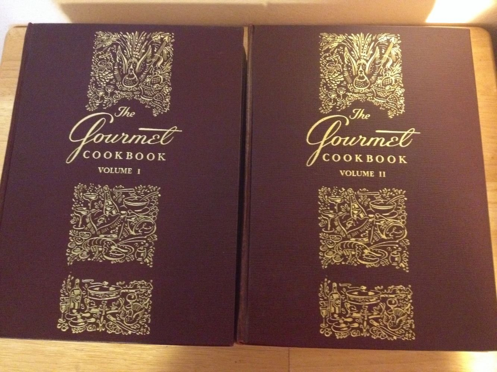

​		晚上能有自己的一个小时是多么令人感觉愉快, 打字机的声音, 和一口泡的柠檬水, 我真的爱了~

​		当初决定一本书不读完不读下一本书, 我pick 了 I feel bad about my neck, 现在第二章, 好长, 读完要累晕了, 废话不多说, 先写一点. 

 # Chapter 3 | Serial Monogamy: A Memoir

​		题目就很有意思: "连续一夫一妻制, 一段回忆", 但是作者是从食谱开始讨论的.

​		第一段,  Nora Ephron 介绍了她母亲给她的第一本食谱, 在1962年, 叫做 "_The Gourmet Cookbook(volume 1)_ "。 作者对这本书的介绍是：

> "a tome, with a gloomy reddish brown binding. It was assembled by the editors of _Gourmet_ magazine and punctuated by the splendid, reverent, slightly lugubrious pictures of food the magazine was famous for."
>
> 
>
> "一本厚重的， 有着红色泛棕色的装订。它被Gourmet 杂志的编辑整合起来并且里面夹着华丽的， 虔诚的， 有点忧郁的食物的图片， 杂志以这些食物著称。"

​		这个介绍很形象。:joy: 下面是这本书的封面图片，看着真的很有气势，我都想买一本了！

​		这本书改变了她母亲的生活。她家里的厨师也开始做别的食物。不久之后，原本不做饭的母亲， 开始在厨房做中国春卷，（这个食谱出现在书本中的第36页），最后

> ​		"but it doesn't begin to convey how stressful  and time-consuming an endeavor it is to make egg rolls, nor does it begin to suggest how much tension a person can create in household by serving egg rolls that take hours to make and make and are not nearly as good as Chinese takeout."

​		哈哈，看来母亲的尝试并不成功啊。好的， first paragraph end！

​		第二段:

> ​		"Owing _The Gourmet Cookbook_ made me feel tremendously sophisticated. For years I gave it to my friends as a wedding present. It was a emblem of adulthood, a way of being smart and chic and college-educated where food was concerned, but I never really used it in the way you're supposed to use a cookbook --- by propping it open on the kitchen counter, cooking from it, staining its pages with spattered butter and  chocolate splotches, conducting a unilateral dialogue with the book itself --- in short, by having a relationship with it." 

​		Nora Ephron 认为这本书是一种成年人, 变得聪明, 时尚, 接受过大学教育, 但是作者从来没用像一本正常的食谱那样使用过它, 和它没有什么联系.

​		第三段, 作者在纽约生活的时候, 使用过的最多的书是 _The Flavor of France_ . 是一个叫做 Jane 的女孩给她的, 作者当时每周收入 55 美元, 但是一份omelet(煎鸡蛋)需要3 美元, 作者直接faint(吓晕了). Jane 介绍了 One Way (如果你和一个女性同一个男人睡了觉, 那你们就是 One Way)...

​		肯尼迪总统"脑洞大开"的时候, Jane 正在举办一个晚宴, 尽管出现了悲剧, 晚宴依旧正常进行. 过了几个月, 她和Jane 成为了 "One Way", 然后友谊就结束了.

​		简单介绍了 _The Flavour of France_ 的作者的家庭情况, 

​		在我到纽约之前, 两个历史事件发生了: 避孕药 和 第一版 Julia Child cookbook, 结果就是everyone was having sec, 并且 after sex, 做一点东西吃饭.

​		在 60 世纪中, 作者作为新闻记者在 _New York Post_ , living  in village. 作者晚上给自己做四个人的饭, 有点幽默.

​		介绍了 Craig Claiborne.

​		想象 Craig Claiborne 来了自己应该准备些什么, 但是没有自己的recipes! 

​		作者结婚, 做了一系列东西, 甚至做了 Lee Lum's lemon chicken. Lee Lum 是Pearl(一家中餐厅)的名字, 然后介绍了 你必须要有地位, 才能在Pearl 餐厅里点一条鱼(This was what it comes down to in New York: You had to have pull to order a fish.)

​		作者去Lee 家里吃饭, 吃的非常好, 导致感觉这顿饭是对过去的rebuke(指责), 

>   ​		"Would Lee Bailey ever in a million years consider cooking the Brazilian national dish? Or Lee Lum's lemon chicken? Certainly not. It was horribly clear that my entire life up to that point had been a mistake."

​		

​		然后作者就... 离婚了. 烹饪风格变得和Lee 一样, 和之前发生了一些转变 ...

​		作者介绍了 Lee 的秘诀, 他 serve 四道菜(不同于其他人的三道), 第四道菜通常是 各式花样的食物, 和其他三样有着非常好的匹配.

​		这里作者又讽刺了一句, 她和Lee 一样, 不 serve 鱼, Fish is not fun. Order it at a restaurant  --- 这里讽刺前面提到的 Lemon Fish.

​		over, 太累了, 读作者的书, My English is so ... so ... poor . haha. 

11.26 晚, 继续,

​		作者的意思: 你可能认为有Lee这种朋友就不需要再幻想他作为一个"幻想中的朋友"了, 但是这样你就错了, 他过于随和, 像一个禅宗僧侣一样, 以至于他认为任何作者喜欢的 菜都可以作为"第四道菜", last sentence :

> ​		"and all of us who fell under his influence began with his style and eventually ended up with our own."

​		

​		"我经常想要Lee会把我的一份食谱放进他的烹饪书中, 他经常来吃晚饭, 但是从来不要任何一张我的食谱,  他用餐巾纸和餐盘在后院拍了张照片放在食谱里, 可是餐巾纸和餐盘也是从他的商店买的, 所以它不算术."

​		author 又结婚, 然后离婚了. 作者开始意识到没有人会把她的食谱放到cookbook里, 所以她自己做了! 

​		后面作者开始提供 5 个菜, 而不是4个, 有时候是 6 个...  

​		作者又结婚了, 这是第三次结婚,  last sentence, 评论了 Nigella 的食谱, 作者喜欢她的 roast beef dinner, 很像她母亲的, 除了 Yorkshire pudding, 她母亲serve 的是potato pancakes. 作者呢?

> ​		"I serve Yorkshire pudding and potato pancakes. "  

​		理由呢?

> ​		"Why not? You only live once."		

​		

​		Ok, over! 第四章会短一点, go on ! 

​		slavish : 奴隶的, 盲从的

​		adulation : 谄媚, 奉承

​		lackadaisical : 无精打采的

​	

 

​		
