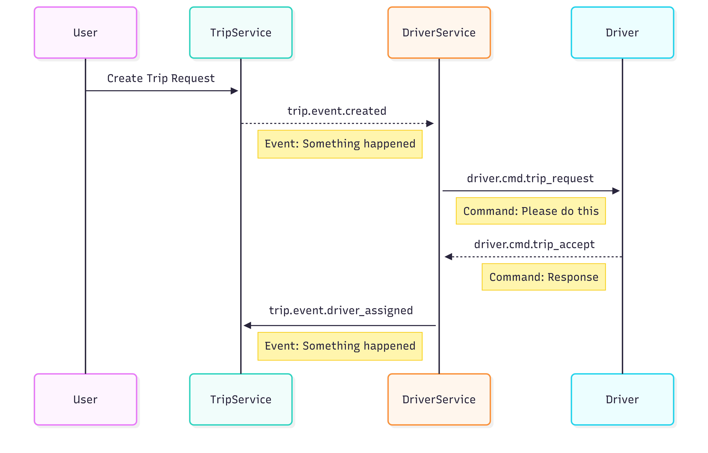

# Golang Microsevices: 1-20

## 10. Architecture Definition Process


recommend page: [Introducing Assemblage - a microservice architecture definition process](https://microservices.io/post/architecture/2023/02/09/assemblage-architecture-definition-process.html)

The relationship of User/ TripService/DriverService/Driver: 




## 11. Effective Error Handling


## 12. Interfaces

具体文章可以参考: [] ()

解读:  **map[string]interface{ }**

### 1. type:

这里是一个map 类型, 包含两个部分:

- 键类型: `string`
- 值类型: `interface{}` , 即空接口

所以有什么好处呢? 一个map 可以这样存放数据:

```go
person["name"]  = "张三"	// 值是 string
person["age"] = 18		// 值是 int
perosn["married"] = true	// 值是 bool
person["hobbies"] = []string{"读书", "跑步"}	//值是切片
```

这样的话:

<b>每个键对应的值可以是完全不同的类型</b>

这在普通的`map[string]int` 或者`map[string]string` 里是做不到的.

### 2. interface{ }

`interface{}`  是一个**空接口:** 一个**没有任何方法要求**的接口, Go 判断一个类型是否实现接口，只看它是否拥有接口要求的全部方法。空接口要求的方法集是**空的**，所以：

> **任何类型都自动实现了空接口。**


这里的代码仅仅解释interface{} 的使用, 不会在最终的代码里.


## Testing


