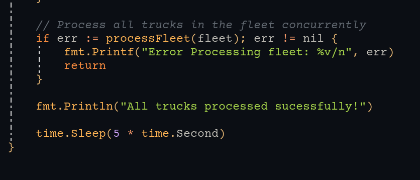
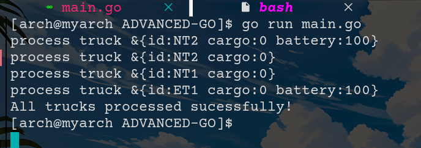

# Golang Microsevices: 1-20

## 10. Architecture Definition Process


recommend page: [Introducing Assemblage - a microservice architecture definition process](https://microservices.io/post/architecture/2023/02/09/assemblage-architecture-definition-process.html)

The relationship of User/ TripService/DriverService/Driver: 


## 11. Effective Error Handling


## 12. Interfaces

具体文章可以参考: [Go语言接口: 鸭子类型与隐式实现] (https://atindoc.github.io/posts/golang/Go%E8%AF%AD%E8%A8%80%E6%8E%A5%E5%8F%A3-%E9%B8%AD%E5%AD%90%E7%B1%BB%E5%9E%8B%E4%B8%8E%E9%9A%90%E5%BC%8F%E5%AE%9E%E7%8E%B0/)

解读:  **map[string]interface{ }**

### 1. type:

这里是一个map 类型, 包含两个部分:

- 键类型: `string`
- 值类型: `interface{}` , 即空接口

所以有什么好处呢? 一个map 可以这样存放数据:

```go
person["name"]  = "张三"	// 值是 string
person["age"] = 18		// 值是 int
perosn["married"] = true	// 值是 bool
person["hobbies"] = []string{"读书", "跑步"}	//值是切片
```

这样的话:

<b>每个键对应的值可以是完全不同的类型</b>

这在普通的`map[string]int` 或者`map[string]string` 里是做不到的.

### 2. interface{ }

`interface{}`  是一个**空接口:** 一个**没有任何方法要求**的接口, Go 判断一个类型是否实现接口，只看它是否拥有接口要求的全部方法。空接口要求的方法集是**空的**，所以：

> **任何类型都自动实现了空接口。**


这里的代码仅仅解释interface{} 的使用, 不会在最终的代码里.


## 13. Testing


介绍了Go语言的方法,


##  14. Pointers


## 15. Goroutines

使用goroutines 之前, 需要逐个处理trucks

```go
func processFleet(trucks []Truck) error {
	for _, t := range trucks {
		processTruck(t)
	}

	return nil
}
```


### 等待执行完成: 方法一: Sleep

如果开启Goroutines, 如果不干预, 由于其是"协程"执行, 会直接退出程序, 我们可以采用"sleep "的方法, 来等待其执行完成, 



<center> 方法一: 在程序最后添加Sleep, 等待执行完成</center>

但是我们并不知道程序什么时候完成, 所以不推荐

### 方法二: 使用 `sync.WaitGroup` 

```go
func processFleet(trucks []Truck) error {
	var wg sync.WaitGroup // 使用sync.WaitGroup

	for _, t := range trucks {
		wg.Add(1) // 添加等待数量

		go func(t Truck) {
			processTruck(t)
			wg.Done()
		}(t)
	}

	wg.Wait() // Wait 等待完成

	return nil
}
```

一个**疑点**:

使用 `go fun(){}(t)` 而不是`go processTruck(t)` , 这是一个`software practice`




<center>使用方法二: 完成之后再退出程序</center>

Sum it up:

**Alway Use Goroutines.**


## 16. Context and Timeouts

Context : has a box that carries contextual information about that request, and it's mostly used to carry information and to cancel a long running request, or just have ability to control the flow around the functions.


## 17. Concurrency with Channels

always hand to hand with groups and goroutines: 

channal act as a pipeline for to send and receive data.

### channel is not buffered  导致死锁

! 提示: all goroutines are asleep - deadlock!

```go
for _, t := range trucks {
    wg.Add(1)

    go func(t Truck) {
        if err := processTruck(ctx, t); err != nil {
            log.Println(err)
            errorsChan <- err  // 发生阻塞
        }
        wg.Done()  // 无法完成
    }(t)
}

wg.Wait()  //  一直wati, 无法j
select {
case err := <-errorsChan:
    return err
default:
    return nil

}
```

原因: `errorsChan` 是无缓冲/ 缓冲不足的 channel
