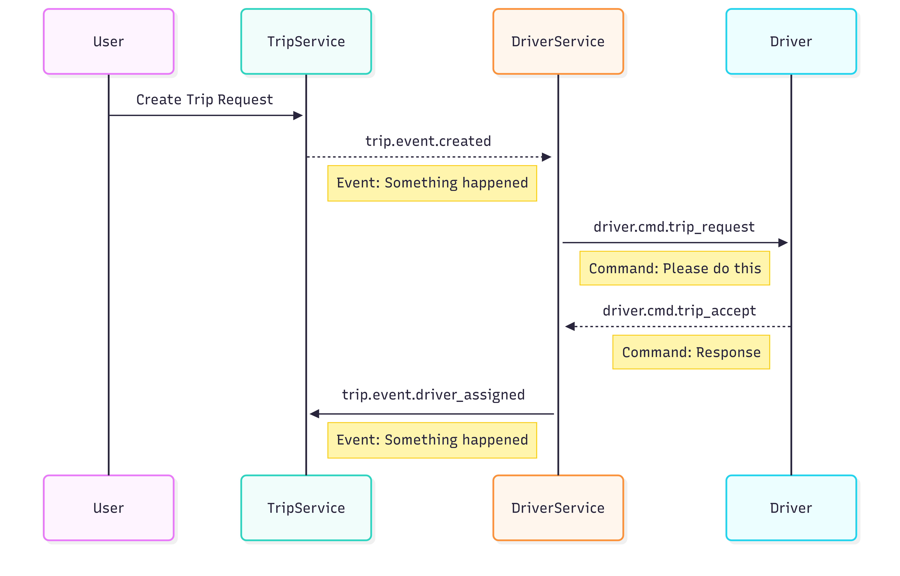

## 10: Architecture Definition Process

recommend page: [Introducing Assemblage - a microservice architecture definition process](https://microservices.io/post/architecture/2023/02/09/assemblage-architecture-definition-process.html)

The relationship of User/ TripService/DriverService/Driver: 

## 11: Effective Error Handling

