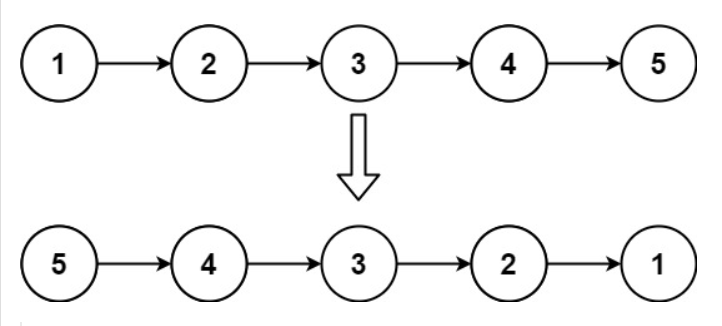

# LeetCode 206 : Reverse Linked List (反转链表)

题目链接 : [LeetCode 206 : Reverse Linked List](https://leetcode.cn/problems/reverse-linked-list/description/?envType=problem-list-v2&envId=2cktkvj)

反转链表, 首先我们有一个头节点, 我们需要的是一个prev 节点, 假设下面有一个新的节点, 我们需要处理当前节点要指向哪个节点, 这个就用prev 来存储, 用cur来表示当前的链表走到哪里了, 这样就可以实现反转链表, 用nxt 保存cur的下一个节点,  

用Example 1 来举例子



假设已经处理完成 2 -> 1, 此时处理 3 -> 2:

那么cur 就是 3, prev 就是 2, nxt 就是 4, 处理完成, cur 移动到4, 继续处理, 代码如下:

```python
class Solution:
    def reverseList(self, head: ListNode | None) -> ListNode | None:
        cur, prev = head, None # 先处理head和它前面的prev(此时就是None)
        while cur:
            nxt = cur.next # 保存cur.next
            cur.next = prev # 反转, 指向前面的节点
            prev = cur # 移动prev, 
            cur = nxt # 移动cur
        return prev
        
```

这也被称为"头插法", 还有一种"尾插法":

使用一种递归的思想, 

```python
class Solution:
    def reverseList(self, head: Optional[ListNode]) -> ListNode | None:
        if head is None or head.next is None:
            return head
       	rev_head = self.reverseList(head.next)
        tail = head.next
        tail.next = head
        head.next = None
        return rev_head
```

理解之后, 会觉得第二种其实更加直观.
