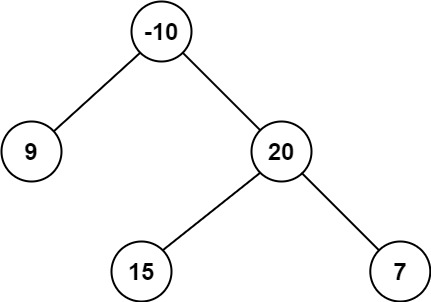

# Hot 100 : 124 : Binary Tree Maximum Path Sum

链接 : [Hot 100 : 124 : Binary Tree Maximum Path Sum](https://leetcode.cn/problems/binary-tree-maximum-path-sum/description/)

​		二叉树最大路径和, 首先二叉树肯定想到 dfs, dfs 可以考虑一个 "小区域" , 以 Example 2 为例:



​		从 root 开始遍历, 左右两个 抽象为 left 和 right , 此时结果就是 -10 + left + right, 这个结果显然不如 右子节点的 15 + 20 + 7, 

​		这时候考虑 "小区域", 进入一个小区域, 应该怎么做:

- 记录当前 root 的路径大小, 比如 20 + 15 + 7, 和已经存在的比较
- 向上传递 (你需要什么, 就也需要传递什么, 20 需要 15  和 7, 那么自己也是一种 "15" / "7")

代码如下:

```python
class Solution:
    def maxPathSum(self, root: TreeNode | None) -> int:
        ans = float("-inf")
        def dfs(node):
            nonlocal ans
            if not node:
                return 0 # 边界条件
            left = max(dfs(node.left), 0)
            right = max(dfs(node.right), 0) # 计算left, right, 可以不取值, 此时取 0
            ans = max(ans, node.val + left + right) # 当前节点的值, 更新 ans
            return node.val + max(left, right) # 向上返回的值
        dfs(root)
        return ans
```


相似题目:

#  543 : Diameter of Binary Tree

链接 :  [LeetCode 543 : Diameter of Binary Tree]()(https://leetcode.cn/problems/diameter-of-binary-tree/)

同样是终止条件, left / right, 更新ans, 然后 return  1 + max(left, right)

代码如下:

```python
class Solution:
    def diameterOfBinaryTree(self, root: Optional[TreeNode]) -> int:
        ans = 0
        if not root:
            return 0

        def dfs(node):
            nonlocal ans
            if not node:
                return 0
            left = dfs(node.left)
            right = dfs(node.right)
            ans = max(ans, left + right + 1)
            return 1 + max(left, right)
        
        dfs(root)
        return ans - 1
```

